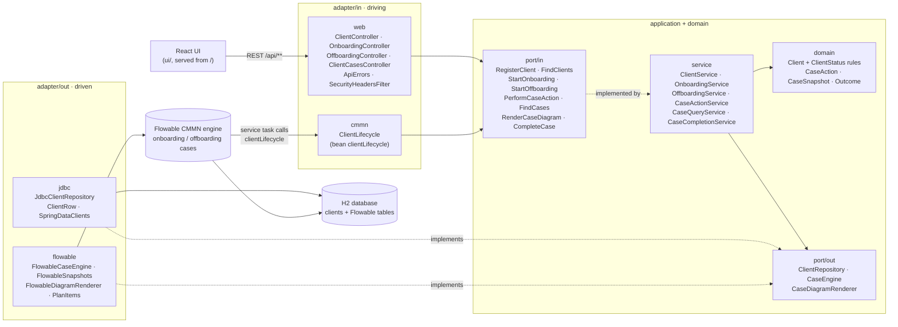

# Clients

A sample client onboarding and offboarding console. It is built with JBang, Spring Boot 3.5,
[Flowable CMMN](https://www.flowable.com/open-source/docs/cmmn/ch06-cmmn) and a React UI
that needs no build step. JBang is the only build tool: there is no Maven, no Gradle and no npm.

> [!WARNING]
> **This project went south.** It runs fine from the terminal with JBang, but in VS Code it
> shows about 1,000 errors across 122 files. The code itself is fine. The editor's Java tooling
> ends up confused. The notes below explain why, so you can avoid the same traps in your own
> JBang projects.

## Why this project doesn't load well in VS Code

Four things combine:

1. **Broken project state in the Java language server.** With
   `java.import.jbang.projectPerScript: true`, the JBang extension creates one project per script
   (`ArchitectureCheck`, `ClientsApp`, `Containerize`, `Native`). Its log repeats
   `Cannot create linked resource '/jdt.ls-java-project/src/ClientsApp.java'. Files cannot be linked to folders.`
   and `Failed to read package name...`. The per-script projects never get their dependencies,
   so the jib-core imports in `Containerize.java` and the ArchUnit imports in
   `ArchitectureCheck.java` show as "cannot be resolved", even though JBang runs both fine.
2. **Generated sources compiled as code.** `build/aot/sources/` holds 118 `.java` files that
   Spring AOT generates for the native build. `.gitignore` excludes `build/`, but the Java
   tooling doesn't read `.gitignore`. It compiles those files and reports package mismatches
   and missing types for each one. They cause most of the errors.
3. **A package declaration that doesn't match the folder.** `ClientsApp.java` declares
   `package app;` but sits in the project root. JBang accepts this. The editor's fallback
   project expects the default package and flags
   `The declared package "app" does not match the expected package ""`.
4. **New files not picked up.** Files pulled in with the `//SOURCES app/**/*.java` wildcard
   aren't always refreshed. `DeleteClient.java` and `ClientNotDeletableException.java` exist,
   but the editor still reports them as missing.


---

## How to run it
```bash
cd clients
./ClientsApp.java    # or: jbang ClientsApp.java
```

Then open http://localhost:8080. The first start downloads the dependencies, and a JDK 25
too if you don't have one.

There is no authentication, so the server only listens on `127.0.0.1`. Use made-up sample data only.

| Variable     | Default          | Purpose                                     |
|--------------|------------------|---------------------------------------------|
| `PORT`       | `8080`           | HTTP port                                   |
| `CLIENTS_DB` | `./data/clients` | H2 database file path, created if missing   |

## The cases

The **client** is the main entity. Its status goes `PROSPECT → ONBOARDING → ACTIVE | REJECTED`, then
`ACTIVE → OFFBOARDING → OFFBOARDED`. A client has at most one active case. A rejected or offboarded client can
be onboarded again.

A client can be deleted from the list unless an onboarding or offboarding is in progress. Deleting
is permanent. It removes the client and its ended cases, including their steps, notes and outcomes, from
Flowable's history, all in one transaction.

Each onboarding or offboarding is a CMMN case (`resources/cases/`). An operator drives every step.

**Onboarding**

```
DRAFT ──submit──▶ OPEN ──decide──▶ FINISHED (SUCCEEDED | FAILED)
                   │  ▲
   request-documents  │ confirm-documents     ← DOCUMENTS_REQUIRED sub-stage
   request-amendment  │ confirm-amendment     ← AMENDMENT_REQUIRED sub-stage
```

The sub-stages are repeatable. The case can't be decided while one of them is pending.

**Offboarding**

```
OPENED ──start-checks──▶ CHECKS_ONGOING ──complete-checks──▶ FINISHED (COMPLETED)
```

## API

| Method | Path | |
|---|---|---|
| `GET`, `POST` | `/api/clients` | List, create `{name, email, country}` |
| `GET` | `/api/clients/{id}` | One client |
| `DELETE` | `/api/clients/{id}` | Permanently delete a client and the history of its ended cases (204). 409 while a case is in progress |
| `GET` | `/api/clients/{id}/cases` | The client's cases, newest first |
| `POST` | `/api/clients/{id}/onboardings` | Start an onboarding |
| `POST` | `/api/clients/{id}/offboardings` | Start an offboarding |
| `GET` | `/api/onboardings[?active=true]`, `/api/onboardings/{caseId}` | Read onboardings |
| `GET` | `/api/offboardings[?active=true]`, `/api/offboardings/{caseId}` | Read offboardings |
| `POST` | `/api/onboardings/{caseId}/actions/{action}` | `submit`, `request-documents`, `confirm-documents`, `request-amendment`, `confirm-amendment`, `decide` |
| `POST` | `/api/offboardings/{caseId}/actions/{action}` | `start-checks`, `complete-checks` |
| `GET` | `/api/onboardings/{caseId}/diagram`, `/api/offboardings/{caseId}/diagram` | PNG of the case model with the current state drawn on it |

The action body is optional: `{"note": "...", "outcome": "APPROVED" | "REJECTED"}`. `decide`
requires `outcome`. Each case response lists its `availableActions`, so the UI shows only the steps
that are valid right now. The diagram comes from Flowable's CMMN image generator, using the layout (CMMNDI) in the case models. The
generator has no way to highlight state, so the app draws it on top: active items green, completed items grey,
available listeners dashed orange, reached milestones filled green. Errors are RFC 7807 `application/problem+json` responses. The status
codes are 400 for invalid input, 404 for an unknown id, and 409 for a step that is not allowed now.

## Layout

The backend follows a hexagonal (ports and adapters) architecture. `ClientsApp.java` holds the
dependencies. It pulls in the Java sources with `//SOURCES` and packages the resources and the UI
into the classpath with `//FILES`.



Dependencies point inwards: adapters depend on the ports, and the core never depends on an adapter.
`ArchitectureCheck.java` enforces this.

| Path | Purpose |
|---|---|
| `ClientsApp.java` | Entry point and JBang header |
| `app/domain/` | Plain Java: the `Client` status rules, case actions, stages and outcomes, and domain errors |
| `app/application/port/in/` | Use cases offered to the adapters (register a client, start a case, perform an action, ...) |
| `app/application/port/out/` | What the core needs from outside: `ClientRepository`, `CaseEngine`, `CaseDiagramRenderer` |
| `app/application/service/` | Use case implementations and transaction boundaries |
| `app/adapter/in/web/` | REST controllers, JSON DTOs, RFC 7807 errors, security headers |
| `app/adapter/in/cmmn/` | `clientLifecycle` bean called by CMMN service tasks when a case finishes |
| `app/adapter/out/jdbc/` | Client persistence with Spring Data JDBC |
| `app/adapter/out/flowable/` | Flowable CMMN: starting cases, operator actions, case state and diagrams |
| `ArchitectureCheck.java` | ArchUnit rules that keep the layers apart (see below) |
| `Native.java`, `native/` | GraalVM native executable build and its recorded metadata (see below) |
| `resources/` | `application.properties`, `schema.sql`, CMMN case models |
| `ui/` | React UI: ES modules through an import map, served from `/` |
| `ui/vendor/` | React, ReactDOM and htm, vendored so the UI works offline (see below) |

Flowable is on both sides. The app drives it through `CaseEngine`, and its service tasks drive
the app back through `clientLifecycle`.

### Vendored UI dependencies

The UI makes no requests to outside hosts. Its three dependencies are esm.sh's ES module bundles,
committed byte for byte in `ui/vendor/`. The import map in `ui/index.html` points at them, and the CSP
allows scripts from `'self'` only.

| File | Source | SHA-256 |
|---|---|---|
| `react.js` | `https://esm.sh/react@19.3.1/es2022/react.bundle.mjs` | `2f35193f9371c059233068567b511f31f3058955238a9aac6b5c007818eed01b` |
| `react-dom-client.js` | `https://esm.sh/react-dom@19.3.1/client?external=react&deps=scheduler@0.28.0&bundle&target=es2022` (follow the stub to `…/client.bundle.mjs`) | `74999c27e08b46e4a9b7f54c8f5474c0ed8592d4569a3e64e634f44f5594efb7` |
| `htm.js` | `https://esm.sh/htm@3.1.1/es2022/htm.bundle.mjs` | `18607eaf2f12307b65a23d3a3f97e90743ecc5c6617773496c221cac513647a9` |

`react-dom-client.js` bundles scheduler 0.28.0. Its only import is the bare `react`, so the page
has a single React instance. To upgrade, download the new bundles, check them with
`shasum -a 256 ui/vendor/*.js`, and update this table. If the import map changes, recompute the
`sha256-…` in the CSP: it is the base64 SHA-256 of the import map script's text. Files
under `ui/vendor/` also need a `//FILES` line in `ClientsApp.java`.

## Tests

With [mise](https://mise.jdx.dev) (after a one-time `mise trust` in this folder):

```bash
mise run test        # both of the below
mise run test:e2e    # starts the app on 127.0.0.1:18080 with a throwaway database, runs clients.hurl, stops it
mise run test:arch   # ArchUnit architecture rules
E2E_PORT=18181 mise run test:e2e    # use another port
```

`test:e2e` fails if the port is already taken or the app doesn't start within 180 seconds, and shows
the last lines of the server log. It always stops the server and deletes the database afterwards.

To run the suite by hand: [`clients.hurl`](clients.hurl) walks through full onboarding, rejection and offboarding flows, and
the error cases, using [Hurl](https://hurl.dev). Start a server with a throwaway database, then run
the suite against it:

```bash
CLIENTS_DB=$(mktemp -d)/db ./ClientsApp.java
hurl --test clients.hurl    # in another terminal
```

`mise.toml` sets the default `base_url` to `http://localhost:8080`. This needs [mise](https://mise.jdx.dev)
active in your shell and a one-time `mise trust` in this folder. Without mise, pass it yourself
with `--variable base_url=http://localhost:8080`.

### Architecture check

```bash
./ArchitectureCheck.java    # or: jbang ArchitectureCheck.java
```

This runs [ArchUnit](https://www.archunit.org) over the app classes and exits non-zero when a
rule is broken:
- `domain` uses only the JDK.
- `application` may also use Spring's `@Service` and `@Transactional`, and nothing else.
- Adapters don't depend on each other.
- Flowable is only used in `adapter/out/flowable` and `adapter/in/cmmn`.

## Native image

[`Native.java`](Native.java) compiles the app ahead of time into a [GraalVM](https://www.graalvm.org)
native executable. It starts in about 0.25 s instead of several seconds and uses less memory. It's still
the same local web server: it serves the same UI and API, reads the same variables and listens on
`127.0.0.1` only.

It needs GraalVM CE for JDK 25. Set `GRAALVM_HOME` to it, or use it as `JAVA_HOME`. The JVM run doesn't need it.

```bash
export GRAALVM_HOME=/path/to/graalvm-community-25
./Native.java                       # writes build/native/clients (takes a few minutes)
CLIENTS_DB=$(mktemp -d)/db ./build/native/clients
hurl --test clients.hurl            # the same suite passes against the native binary
```

There's no Maven or Gradle plugin, so the script does their work:

1. `jbang export portable` builds the app jar and its dependency jars, the same as `Containerize.java`.
2. Spring AOT (`SpringApplicationAotProcessor`) generates the bean wiring as code, plus native hints,
   into `build/aot/`. GraalVM's `javac` compiles that code.
3. `native-image` builds the executable. It uses Spring's hints and the reachability metadata in
   [`native/`](native/).

**Metadata.** Flowable, MyBatis, H2 and Java2D have no native-image metadata of their own. `native/` holds
it, and it's committed so that a normal build doesn't need a recording run. `./Native.java --collect`
re-records it: it runs the app on the JVM with GraalVM's tracing agent, drives every flow with `clients.hurl`
(synthetic data, in a throwaway database), and writes what was used to `native/reachability-metadata.json`.
Re-run it after changing `//DEPS`, the CMMN models or their expressions. If you see a
`MissingReflectionRegistrationError`, add the type to a `RuntimeHintsRegistrar`, like
`app/adapter/out/jdbc/JdbcNativeHints.java`. That's for code the agent can't see on the JVM, such as Spring
Data's generated accessors.

**Notes**
- The binary only runs on the OS and architecture it was built on. The case diagrams use Java2D, so
  `build/native/` also holds the AWT `.dylib`/`.so` libraries and `lib/fontconfig.bfc`. Keep them
  next to `clients`. A native image has no `java.home`, so `ClientsApp` sets it to the binary's folder.
- `--skip-build` stops after AOT (and after `--collect`, if you pass both). `--verbose` shows the hidden tool output.
- `--linux` builds a Linux binary in a container instead. See [Native container image](#native-container-image).

## Container

The image is built with [Jib](https://github.com/GoogleContainerTools/jib), driven from a JBang script.
There's no Dockerfile, and no Docker daemon is needed to build.

```bash
./Containerize.java                 # writes build/clients-image.tar (clients:<git-short-sha>)
./Containerize.java --help          # all options: --base, --tag, --platform, --push
mise run containerize               # the same, as a mise task (needs a one-time `mise trust`)
mise run containerize --platform linux/amd64      # arguments after the task name are passed through
```

`Containerize.java` runs `jbang export portable` to get the app jar and its dependency jars. It then
uses Jib to put them on top of `eclipse-temurin:25-jre`, pinned by digest, in two layers:

| Layer | Contents | Changes when |
|---|---|---|
| `dependencies` | `/app/lib/*.jar` | `//DEPS` change |
| `application` | `/app/ClientsApp.jar` (code, resources, UI) | any code change |

The container runs as the non-root user `10001`. It listens on `0.0.0.0:8080` inside the
container (`SERVER_ADDRESS`) and keeps the H2 database in the `/data` volume. Builds are
reproducible: the same inputs give the same image digest.

**Running it** needs some container runtime, but only to run the image, not to build it:

```bash
docker load -i build/clients-image.tar      # or: podman load -i build/clients-image.tar
docker run --rm -p 127.0.0.1:8080:8080 -v clients-data:/data clients:<tag>
```

There's no authentication, so always publish the port on `127.0.0.1` only, and use made-up data.

**Pushing** with `--push <image-ref>` builds for `linux/amd64` and `linux/arm64`. It asks for
confirmation before uploading anything, and only accepts a reference with an explicit registry host,
so nothing goes to Docker Hub by default. Credentials come only from your Docker config or a credential
helper (for ECR, `docker-credential-ecr-login`), never from arguments. Push only to the company-approved
registries. The Docker Hub Temurin base suits a local sample. For anything shared or deployed, check that
it meets the company's base-image policy, or use `--base` with an approved internal image.

### Native container image

```bash
./Containerize.java --native        # writes build/clients-native-image.tar (clients:<git-short-sha>-native)
docker load -i build/clients-native-image.tar
docker run --rm -p 127.0.0.1:8080:8080 -v clients-data:/data clients:<tag>-native
```

The image runs the Linux native executable instead of the JVM. It starts in about 0.35 s, and it has the
same user, `/data` volume, port and variables as the JVM image. A Linux binary has to be compiled on Linux, so
this variant needs more than the JVM one:
- `GRAALVM_HOME`, for the Spring AOT step on the host.
- `docker` or `podman`. It runs `native-image` in `ghcr.io/graalvm/native-image-community:25`, pinned by
  digest in `Native.java` (`LINUX_BUILDER`; refresh it with
  `docker buildx imagetools inspect ghcr.io/graalvm/native-image-community:25`). The builder runs with
  `--network none`, as your uid, with `clients/` mounted at `/work`. Jib still assembles the image.
- About 4 minutes and about 7 GB of RAM in the container VM.

The image only has the platform of your container runtime (for example `linux/arm64` on Apple silicon).
`--platform` must match it, and `--push` uploads that one platform only, which the confirmation prompt says.
The base is the same pinned Temurin image, because the diagrams need its fontconfig, fonts and freetype.
It also carries a JRE the native binary doesn't use. A smaller base would need those fonts and libraries;
check any base against the company's base-image policy.

`./Native.java --linux` builds just the binary, into `build/native-linux/`. Keep `lib/` (it must exist, even
empty, or Java2D skips the system fontconfig) and the `.so` files next to `clients`.

**Linux metadata.** Linux uses different Java2D code paths, so `native/linux/` adds to `native/` for Linux
builds. `./Native.java --linux --collect` re-records it. It runs the app under the tracing agent inside
the pinned Temurin base (`LINUX_RUNTIME_BASE`, which must stay equal to `DEFAULT_BASE` in
`Containerize.java`), with the builder's GraalVM mounted read-only. This needs Docker 28+ or Podman, plus
Hurl. The app only listens on `127.0.0.1`, and its database is thrown away afterwards.
On Linux native images, `ClientsApp` sets `sun.font.layout.ffm=false`. That's because Java2D's FFM HarfBuzz
text layout crashes there (linux/arm64, GraalVM 25.0.2), and the JNI layout gives the same result.

Not tested yet: `--native` with `--push`, Podman, and linux/amd64.

## Troubleshooting

### The app fails at startup: `@ComponentScan of the default package`

On 8 November `./ClientsApp.java` stopped starting, though it still compiled. Spring Boot failed like this:

```
WARN  ** WARNING ** : Your ApplicationContext is unlikely to start due to a @ComponentScan of the default package.
ERROR Application run failed
BeanDefinitionStoreException: Failed to read candidate component class: ...spring-boot-autoconfigure-3.5.16.jar!/org/springframework/boot/autoconfigure/r2dbc/ConnectionFactoryConfigurations$PoolConfiguration.class
Caused by: java.lang.NoClassDefFoundError: io/r2dbc/spi/ValidationDepth
```

**What happened.** `ClientsApp.java` had lost its `package app;` line. VS Code's Java extension removed it.
VS Code opens `clients/` as a project without Maven or Gradle and treats the folder itself as the source root. To it, a
file at the root belongs to the default package, so it flagged `package app;` as *"The declared package "app" does
not match the expected package """*. Its quick fix, **Correct package declaration**, deleted the line. VS Code's
local history recorded that quick fix at the same minute the file was last changed. Ten minutes earlier the full
test suite had passed.

**Why one line breaks everything.** `@SpringBootApplication` scans the package of the class that carries it. With
`package app;` that is `app.*`, which is the whole application and nothing else. In the default package it is the whole
classpath, including Spring Boot's own `org.springframework.boot.autoconfigure.*` classes. Those are meant to be loaded
only after their `@Conditional` checks pass. When the scan reads them directly, the R2DBC one needs `io.r2dbc.spi`,
which isn't a dependency, so startup fails. The package also matters elsewhere:
- Spring Data JDBC looks for repositories (`SpringDataClients`) in the same base package.
- `Native.java` starts `app.ClientsApp` (`MAIN_CLASS`), and Spring AOT generates `app.ClientsApp__*` classes.
- `ArchitectureCheck.java` checks the classes in package `app`.

**The fix.** Keep `package app;` right after the `//FILES` header lines. JBang doesn't care that the file sits
outside an `app/` folder. Only the IDE warns about it. Ignore that warning and don't apply the quick fix.

Another way to do it is to leave `ClientsApp` in the default package and add `@SpringBootApplication(scanBasePackages = "app")`
plus `@EnableJdbcRepositories(basePackages = "app")`. That isn't used here, because `Native.java` and the AOT step
expect `app.ClientsApp`.
