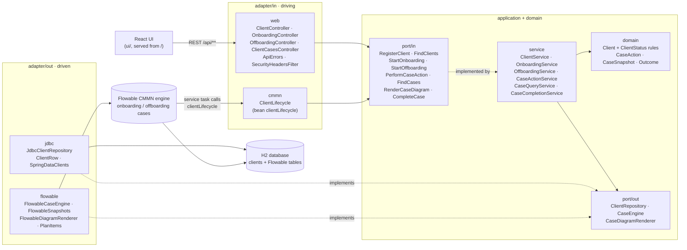

# Clients v2

A sample client onboarding and offboarding console. It is built with JBang, Spring Boot 3.5,
[Flowable CMMN](https://www.flowable.com/open-source/docs/cmmn/ch06-cmmn) and a React UI
that needs no build step. JBang is the only build tool: there is no Maven, no Gradle and no npm.

```bash
cd clientsv2
./ClientsApp.java    # or: jbang ClientsApp.java
```

Then open http://localhost:8080. The first start downloads the dependencies, and a JDK 25
too if you don't have one.

There is no authentication, so the server only listens on `127.0.0.1`. Use made-up sample data only.

| Variable     | Default          | Purpose                                     |
|--------------|------------------|---------------------------------------------|
| `PORT`       | `8080`           | HTTP port                                   |
| `CLIENTS_DB` | `./data/clients` | H2 database file path, created if missing   |

## The cases

The **client** is the main entity. Its status goes `PROSPECT → ONBOARDING → ACTIVE | REJECTED`, then
`ACTIVE → OFFBOARDING → OFFBOARDED`. A client has at most one active case. A rejected or offboarded client can
be onboarded again.

Each onboarding or offboarding is a CMMN case (`resources/cases/`). An operator drives every step.

**Onboarding**

```
DRAFT ──submit──▶ OPEN ──decide──▶ FINISHED (SUCCEEDED | FAILED)
                   │  ▲
   request-documents  │ confirm-documents     ← DOCUMENTS_REQUIRED sub-stage
   request-amendment  │ confirm-amendment     ← AMENDMENT_REQUIRED sub-stage
```

The sub-stages are repeatable. The case can't be decided while one of them is pending.

**Offboarding**

```
OPENED ──start-checks──▶ CHECKS_ONGOING ──complete-checks──▶ FINISHED (COMPLETED)
```

## API

| Method | Path | |
|---|---|---|
| `GET`, `POST` | `/api/clients` | List, create `{name, email, country}` |
| `GET` | `/api/clients/{id}` | One client |
| `GET` | `/api/clients/{id}/cases` | The client's cases, newest first |
| `POST` | `/api/clients/{id}/onboardings` | Start an onboarding |
| `POST` | `/api/clients/{id}/offboardings` | Start an offboarding |
| `GET` | `/api/onboardings[?active=true]`, `/api/onboardings/{caseId}` | Read onboardings |
| `GET` | `/api/offboardings[?active=true]`, `/api/offboardings/{caseId}` | Read offboardings |
| `POST` | `/api/onboardings/{caseId}/actions/{action}` | `submit`, `request-documents`, `confirm-documents`, `request-amendment`, `confirm-amendment`, `decide` |
| `POST` | `/api/offboardings/{caseId}/actions/{action}` | `start-checks`, `complete-checks` |
| `GET` | `/api/onboardings/{caseId}/diagram`, `/api/offboardings/{caseId}/diagram` | PNG of the case model with the current state drawn on it |

The action body is optional: `{"note": "...", "outcome": "APPROVED" | "REJECTED"}`. `decide`
requires `outcome`. Each case response lists its `availableActions`, so the UI shows only the steps
that are valid right now. The diagram comes from Flowable's CMMN image generator, using the layout (CMMNDI) in the case models. The
generator has no way to highlight state, so the app draws it on top: active items green, completed items grey,
available listeners dashed orange, reached milestones filled green. Errors are RFC 7807 `application/problem+json` responses. The status
codes are 400 for invalid input, 404 for an unknown id, and 409 for a step that is not allowed now.

## Layout

The backend follows a hexagonal (ports and adapters) architecture. `ClientsApp.java` holds the
dependencies. It pulls in the Java sources with `//SOURCES` and packages the resources and the UI
into the classpath with `//FILES`.



Dependencies point inwards: adapters depend on the ports, and the core never depends on an adapter.
`ArchitectureCheck.java` enforces this.

| Path | Purpose |
|---|---|
| `ClientsApp.java` | Entry point and JBang header |
| `app/domain/` | Plain Java: the `Client` status rules, case actions, stages and outcomes, and domain errors |
| `app/application/port/in/` | Use cases offered to the adapters (register a client, start a case, perform an action, ...) |
| `app/application/port/out/` | What the core needs from outside: `ClientRepository`, `CaseEngine`, `CaseDiagramRenderer` |
| `app/application/service/` | Use case implementations and transaction boundaries |
| `app/adapter/in/web/` | REST controllers, JSON DTOs, RFC 7807 errors, security headers |
| `app/adapter/in/cmmn/` | `clientLifecycle` bean called by CMMN service tasks when a case finishes |
| `app/adapter/out/jdbc/` | Client persistence with Spring Data JDBC |
| `app/adapter/out/flowable/` | Flowable CMMN: starting cases, operator actions, case state and diagrams |
| `ArchitectureCheck.java` | ArchUnit rules that keep the layers apart (see below) |
| `resources/` | `application.properties`, `schema.sql`, CMMN case models |
| `ui/` | React UI: ES modules through an import map, served from `/` |
| `ui/vendor/` | React, ReactDOM and htm, vendored so the UI works offline (see below) |

Flowable is on both sides. The app drives it through `CaseEngine`, and its service tasks drive
the app back through `clientLifecycle`.

### Vendored UI dependencies

The UI makes no requests to outside hosts. Its three dependencies are esm.sh's ES module bundles,
committed byte for byte in `ui/vendor/`. The import map in `ui/index.html` points at them, and the CSP
allows scripts from `'self'` only.

| File | Source | SHA-256 |
|---|---|---|
| `react.js` | `https://esm.sh/react@19.3.1/es2022/react.bundle.mjs` | `2f35193f9371c059233068567b511f31f3058955238a9aac6b5c007818eed01b` |
| `react-dom-client.js` | `https://esm.sh/react-dom@19.3.1/client?external=react&deps=scheduler@0.28.0&bundle&target=es2022` (follow the stub to `…/client.bundle.mjs`) | `74999c27e08b46e4a9b7f54c8f5474c0ed8592d4569a3e64e634f44f5594efb7` |
| `htm.js` | `https://esm.sh/htm@3.1.1/es2022/htm.bundle.mjs` | `18607eaf2f12307b65a23d3a3f97e90743ecc5c6617773496c221cac513647a9` |

`react-dom-client.js` bundles scheduler 0.28.0. Its only import is the bare `react`, so the page
has a single React instance. To upgrade, download the new bundles, check them with
`shasum -a 256 ui/vendor/*.js`, and update this table. If the import map changes, recompute the
`sha256-…` in the CSP: it is the base64 SHA-256 of the import map script's text. Files
under `ui/vendor/` also need a `//FILES` line in `ClientsApp.java`.

## Tests

With [mise](https://mise.jdx.dev) (after a one-time `mise trust` in this folder):

```bash
mise run test        # both of the below
mise run test:e2e    # starts the app on 127.0.0.1:18080 with a throwaway database, runs clients.hurl, stops it
mise run test:arch   # ArchUnit architecture rules
E2E_PORT=18181 mise run test:e2e    # use another port
```

`test:e2e` fails if the port is already taken or the app doesn't start within 180 seconds, and shows
the last lines of the server log. It always stops the server and deletes the database afterwards.

To run the suite by hand: [`clients.hurl`](clients.hurl) walks through full onboarding, rejection and offboarding flows, and
the error cases, using [Hurl](https://hurl.dev). Start a server with a throwaway database, then run
the suite against it:

```bash
CLIENTS_DB=$(mktemp -d)/db ./ClientsApp.java
hurl --test clients.hurl    # in another terminal
```

`mise.toml` sets the default `base_url` to `http://localhost:8080`. This needs [mise](https://mise.jdx.dev)
active in your shell and a one-time `mise trust` in this folder. Without mise, pass it yourself
with `--variable base_url=http://localhost:8080`.

### Architecture check

```bash
./ArchitectureCheck.java    # or: jbang ArchitectureCheck.java
```

This runs [ArchUnit](https://www.archunit.org) over the app classes and exits non-zero when a
rule is broken:
- `domain` uses only the JDK.
- `application` may also use Spring's `@Service` and `@Transactional`, and nothing else.
- Adapters don't depend on each other.
- Flowable is only used in `adapter/out/flowable` and `adapter/in/cmmn`.
